# Linux XTU (`linux-xtu`)

**Undervolt, overclock and power-tune Intel Core Ultra 200S (Arrow Lake) from Linux. Live, per core, with every write reviewed, confirmed and read back.**

Not affiliated with or endorsed by Intel. XTU is a trademark of Intel Corporation.

Linux XTU reads and tunes an Intel Core Ultra 200S desktop processor (Arrow Lake-S) while the machine runs:

- **Per-point V/F offsets** for every P-core, every E-core cluster and the ring: the curve, not one global offset
- **OC ratios and target voltages**, **turbo ratio tables**, **PL1 / PL2 / tau**, ratio caps and the ring clock range
- **Live telemetry**: clocks, load, requested voltage, temperatures, package power, and the limit that is holding the CPU back right now
- **Stress screens** (stress-ng / stressapptest) tied to the exact state they tested; **V/F curve measurement**
- **Profiles**: save the CPU state, mark a known-good one as *accepted*, restore it after a reboot (optionally at every boot, crash-loop guarded)
- **Windows**: one PowerShell command re-applies a profile you saved on Linux

It is a desktop app (an AppImage) plus a small root helper that does the privileged work. Nothing reaches the CPU without a Review, a system
confirmation dialog that lists every value, and a read-back of every write. Values outside what the CPU itself reports as its limits are refused.
Every request is in an audit log.

## Quick start
1. **Download** `linux-xtu-<version>-x86_64.AppImage` and `SHA256SUMS` from [Releases](https://github.com/xyehya/linux-xtu/releases) into `~/Downloads`, then
   check it: `cd ~/Downloads && sha256sum -c SHA256SUMS && cd -`.
2. **Get the code** (the root helper is installed from it): `git clone https://github.com/xyehya/linux-xtu.git && cd linux-xtu`.
3. **Keep the AppImage** where programs live (the menu entry points at it): `mkdir -p ~/Applications && mv ~/Downloads/linux-xtu-*-x86_64.AppImage ~/Applications/ && chmod +x ~/Applications/linux-xtu-*-x86_64.AppImage`.
4. **Install the helper**: `sudo bash install.sh --appimage "$(ls ~/Applications/linux-xtu-*-x86_64.AppImage)"`, then log out and in once (section 5).
5. **Start Linux XTU** from your menu, press **Read**, and follow [a first safe tuning session](#7-a-first-safe-tuning-session).

Tested on a Core Ultra 9 285K (ASRock Z890, Fedora, GNOME Wayland). It writes undocumented processor registers: read
[section 1](#1-what-it-is-what-it-can-and-cannot-break) before your first write.

## Screenshots
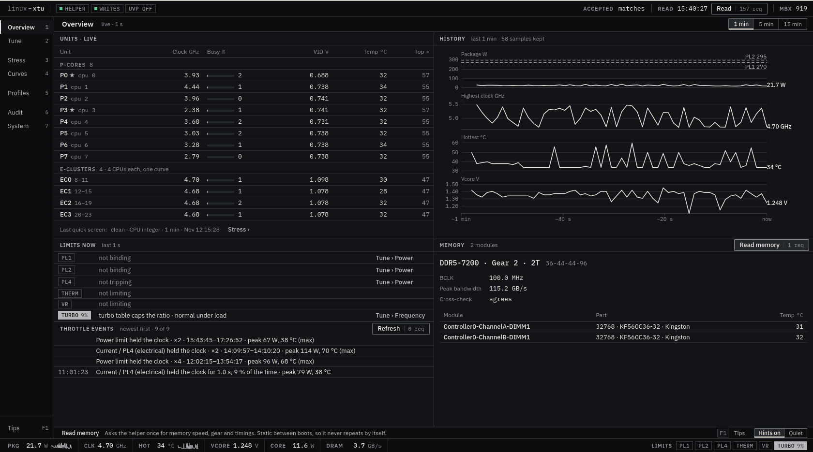
*Overview: every core and cluster live, the history, the limit holding the CPU back right now, memory speed and timings.*

| | |
|---|---|
| 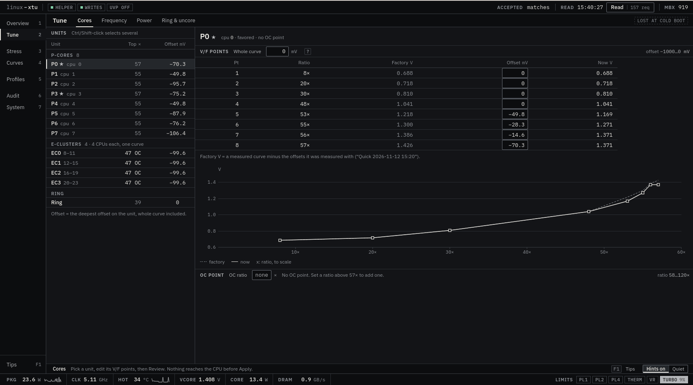 | 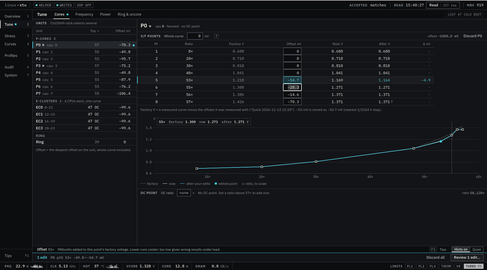 |
| *Tune › Cores: every V/F point with its factory voltage, offset and resulting voltage.* | *An edit predicts the new voltage and stays cyan until the CPU holds it.* |
| 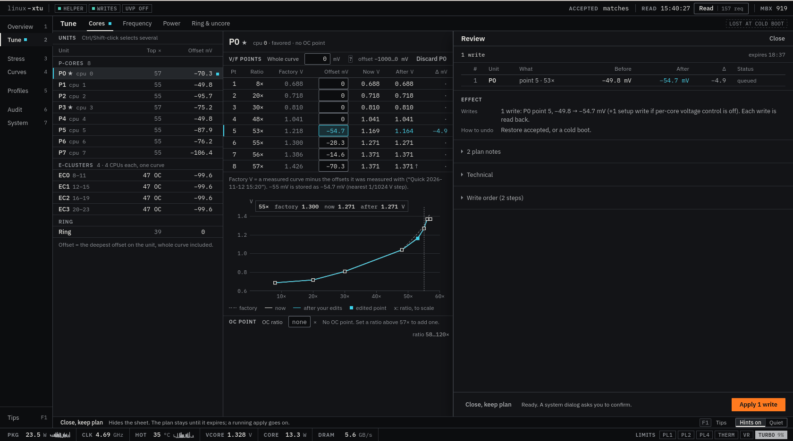 | 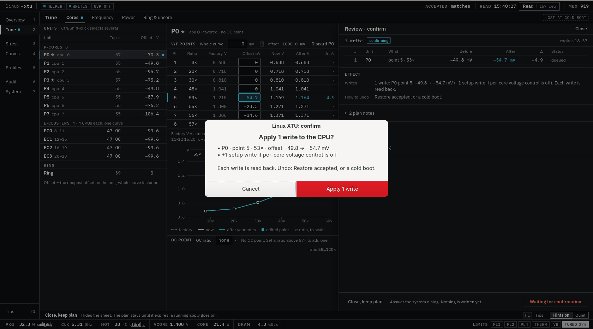 |
| *Review: every write with its before and after, and how to undo it.* | *A system dialog, outside the web view, lists every value before anything is written.* |
| 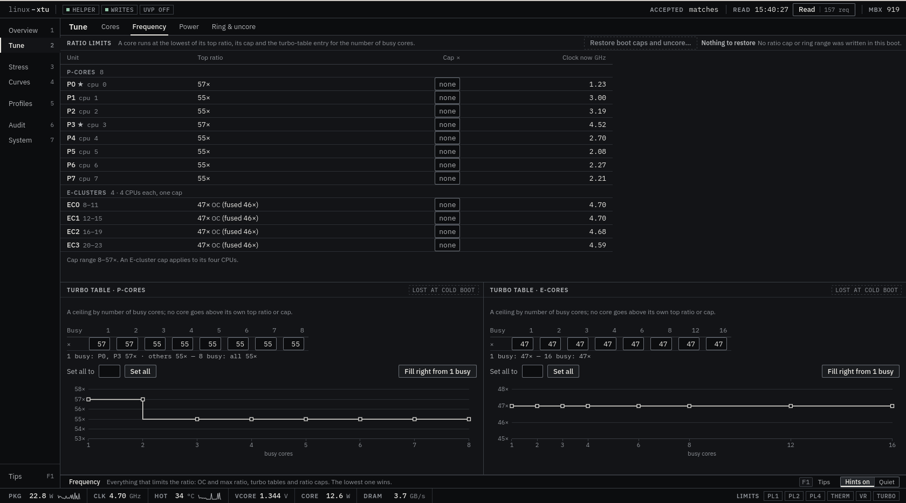 | 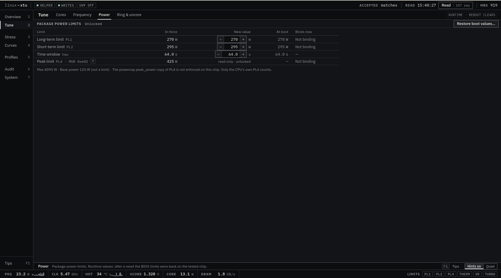 |
| *Frequency: each core's top ratio and cap; the turbo tables are ceilings by busy-core count.* | *Power: PL1 / PL2 / tau, their boot values and whether they bind; PL4 read-only.* |
| 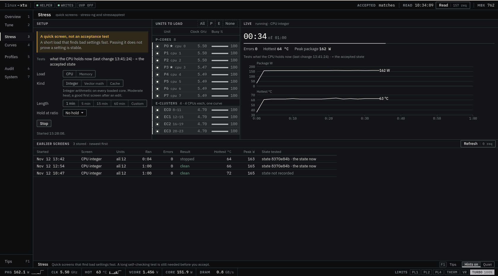 | 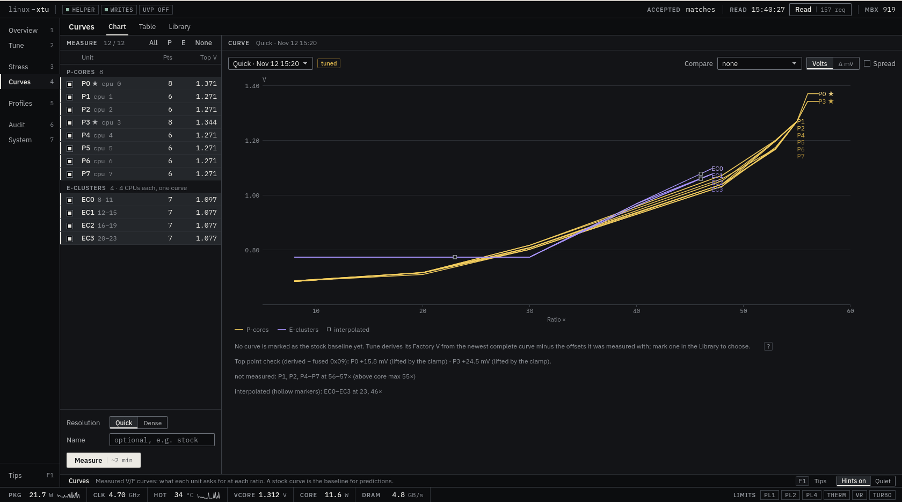 |
| *Stress: a quick screen of the state the CPU holds now, tied to that state.* | *Curves: measure what each core asks for at each ratio.* |
| 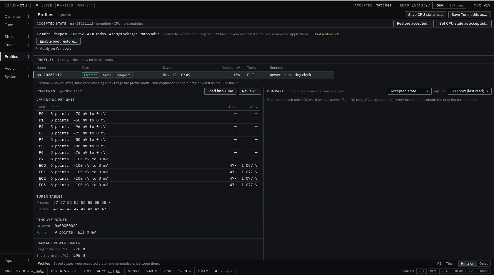 | 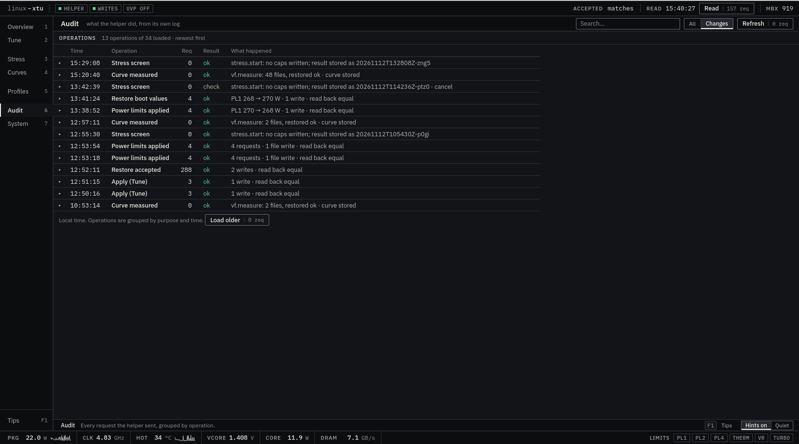 |
| *Profiles: save, accept, restore, compare; apply on Windows with one command.* | *Audit: every request the helper sent, grouped by operation.* |

The rest of this README is the complete setup and first-use guide, in the order you do it. Every command can be copied as it is. Background and
reference pages: [`docs/guide/`](docs/guide/README.md).

## Contents
1. [What it is, what it can and cannot break](#1-what-it-is-what-it-can-and-cannot-break)
2. [Requirements](#2-requirements)
3. [Get the code and run the offline tests](#3-get-the-code-and-run-the-offline-tests)
4. [Build the AppImage](#4-build-the-appimage)
5. [Install the root helper](#5-install-the-root-helper)
6. [First run of the app](#6-first-run-of-the-app)
7. [A first safe tuning session](#7-a-first-safe-tuning-session)
8. [Optional: restore the accepted state at every boot](#8-optional-restore-the-accepted-state-at-every-boot)
9. [Windows: apply your saved profile with one command](#9-windows-apply-your-saved-profile-with-one-command)
10. [Troubleshooting](#10-troubleshooting)
11. [Uninstall](#11-uninstall)
12. [For developers](#12-for-developers)

## 1. What it is, what it can and cannot break

**Supported hardware.** Intel Core Ultra 200S desktop processors, Arrow Lake-S (CPU family 6, model 198), on Linux running directly on the machine (not
in a virtual machine). It was developed and tested on one machine: a Core Ultra 9 285K on an ASRock Z890 board. Other 200S models and other boards are
expected to work but are untested. Everything the app shows (core counts, factory voltages, ratios, limits) is read from your CPU; nothing is assumed
from the reference machine. On another CPU the app is read-only or refuses to start.

**What it changes.** Values inside the processor while it runs. Nothing is written to the BIOS or to disk on the CPU side.

**What it cannot break permanently.** A **cold boot** (power off, then on) puts every value back to what your BIOS sets. That is the universal undo. A warm
restart can keep some voltage offsets, so the app reads the CPU again after every boot. The app refuses values outside what the CPU reports as its own
limits.

**What it can break.** An undervolt that is too deep makes the machine crash or, worse, compute wrong results without any error message (a corrupted
file, a failed build). Only long self-checking tests find that (section 7). Overclocking raises voltage and heat. You are responsible for what you apply.

**BIOS Undervolt Protection must be off** for negative voltage offsets (section 2.2). With it on, the CPU refuses every undervolt and the app says so.

## 2. Requirements

### 2.1 Software
Developed on Fedora (44/45). The commands below are given for Fedora and for Debian/Ubuntu; the Debian/Ubuntu names follow the usual package names and
were not tested by the project.

| Need | Why | Fedora | Debian 13 / Ubuntu 24.04 or newer |
|---|---|---|---|
| Python 3.12 or newer | the root helper and the tests (standard library only, nothing from pip) | `python3` | `python3` (Debian 12 has 3.11: too old) |
| git | get the code | `git` | `git` |
| C compiler, `file`, `curl` | build the app | `gcc`, `file`, `curl` | `build-essential`, `file`, `curl` |
| WebKitGTK 4.1 + GTK 3 dev files, OpenSSL, tray icon and SVG libraries | what Tauri 2 needs to build the app | `webkit2gtk4.1-devel gtk3-devel openssl-devel libappindicator-gtk3-devel librsvg2-devel` | `libwebkit2gtk-4.1-dev libgtk-3-dev libssl-dev libayatana-appindicator3-dev librsvg2-dev` |
| Rust toolchain (cargo) | build the app | via rustup (below) | via rustup (below) |
| `tauri-cli` 2 | the build tool | `cargo install tauri-cli --version "^2" --locked` | same |
| FUSE (`fusermount`) | to start an AppImage directly | `fuse` or `fuse3` (normally installed) | `fuse3` |
| systemd | starts the root helper on demand | normally installed | normally installed |
| `msr` kernel driver | the access path to the CPU | built into the Fedora kernel | a module: `sudo modprobe msr` (section 2.3) |
| optional: `stress-ng`, `stressapptest` | the Stress screen (CPU and memory quick screens) | `stress-ng stressapptest` | `stress-ng stressapptest` |
| optional: `node`, Chrome/Chromium | only for the UI part of the offline tests | `nodejs`, `chromium` | `nodejs`, `chromium` |

Fedora, in one go:
```
sudo dnf install git gcc file curl python3 webkit2gtk4.1-devel gtk3-devel openssl-devel libappindicator-gtk3-devel librsvg2-devel stress-ng stressapptest
```
Debian / Ubuntu:
```
sudo apt install git build-essential file curl python3 libwebkit2gtk-4.1-dev libgtk-3-dev libssl-dev libayatana-appindicator3-dev librsvg2-dev fuse3 stress-ng stressapptest
```
Rust (rustup, installs into your home directory) and the Tauri build tool (compiles for a few minutes):
```
curl --proto '=https' --tlsv1.2 -sSf https://sh.rustup.rs | sh
source "$HOME/.cargo/env"
cargo install tauri-cli --version "^2" --locked
cargo tauri --version          # tauri-cli 2.x (2.12.3 was used to write this guide)
python3 --version              # 3.12 or newer
```
Tauri's own list of Linux prerequisites, if a build complains about a missing library: <https://v2.tauri.app/start/prerequisites/>.

### 2.2 BIOS settings (once)
Names vary by board vendor; look under the CPU / overclocking / voltage pages.

| Setting | Set to | What happens otherwise |
|---|---|---|
| **Undervolt Protection (UVP)** | Disabled | The CPU refuses every negative offset. The app's top bar shows `UVP ON`, offset fields are locked, and an Apply is refused with "Undervolt Protection is on". Ratios and turbo tables still work. |
| **OC Lock / Overclocking Lock** (if present) | Disabled | Every tuning write is refused by the CPU. |
| Overclocking support / "OC" switch (some boards) | Enabled | Some boards hide the CPU's tuning interface without it. |
| Your BIOS's own per-core voltage offsets / undervolt (if it has them) | Auto / 0 | They add to what the app writes. The app reads what the CPU holds, so a BIOS offset appears as the starting value after **Read** and becomes part of anything you save. |
| Secure Boot | Off, or a kernel without lockdown | See 2.3: with lockdown the app is read-only. |

### 2.3 Kernel checks
```
grep -m3 -E '^(cpu family|model|stepping)\s*:' /proc/cpuinfo   # cpu family 6, model 198
ls /dev/cpu/0/msr                                              # must exist
cat /sys/kernel/security/lockdown                              # [none] must be the selected word
```
- `/dev/cpu/0/msr` missing: `sudo modprobe msr` (Debian/Ubuntu load it as a module; `lsmod | grep msr` shows it). Add `--load-msr` to the install
  command in section 5 to load it at every boot. On Fedora the driver is built into the kernel (`lsmod` does not list it; nothing to do).
- Lockdown `[integrity]` or `[confidentiality]`: usually Secure Boot. Kernel lockdown blocks MSR writes, so the app can only show data
  (`READ-ONLY` in the top bar). Check Secure Boot with `mokutil --sb-state`; turn it off in the BIOS, or boot a kernel without lockdown.
- The first tuning write of every boot logs `msr: Write to unrecognized MSR 0x150 ... tainting CPU_OUT_OF_SPEC` in the kernel log and sets taint bit 2.
  That is expected; the helper is configured to accept exactly that bit.

Do not run another tuning tool at the same time (Intel XTU on Windows aside: HWiNFO's or OCCT's driver as root, ThrottleStop, vendor tools). One program
at a time talks to the CPU's tuning mailbox.

## 3. Get the code and run the offline tests
```
git clone https://github.com/xyehya/linux-xtu.git
cd linux-xtu
python3 tools/run_tests.py
```
(If you have the code another way, for example as an archive or a private copy, unpack it and `cd` into it. The installer copies from this folder, so
keep it writable only by you.)

The test suite runs entirely against a simulator: no root, no hardware. A full run took about 9 minutes here: 3.5 minutes of Python tests, the UI tests,
two test builds of the app's Rust code (under `~/.cache/linux-xtu-desktop-target`, which grows to several GB; the very first build takes longer) and
4.5 minutes rendering every UI state in headless Chrome. Green looks like this (excerpts, in this order):

```
Ran 3599 tests in 217.240s

OK
...
ℹ pass 660
ℹ fail 0
...
test result: ok. 62 passed; 0 failed; ...
...
77 renders (77 states x 1 size(s)) in 272s, 0 with problems
```
and the command exits with status 0 (`echo $?` prints `0`). The numbers change as the project grows; what matters is `OK`, `fail 0`, `0 failed` and
`0 with problems`. Missing optional tools print `skipped: node missing`, `skipped: cargo missing` or `visual_capture: SKIPPED, ...` (no Chrome) and do not fail the run.

Only the Python part (about 4 minutes, no Rust, node or Chrome):
```
LINUX_XTU_SKIP_DESKTOP_TESTS=1 python3 tools/run_tests.py
```

## 4. Build the AppImage
**Or skip this section:** download the AppImage and `SHA256SUMS` from [Releases](https://github.com/xyehya/linux-xtu/releases), check them with
`sha256sum -c SHA256SUMS`, and continue at "Put the AppImage where you keep programs" below.

From the repository folder:
```
bash desktop/tools/build-appimage.sh
```
What it does:
1. Checks that the development-only socket option can never be built into the release (it prints `ok: release build with dev-socket is refused`).
2. Compiles the app in release mode. The first build downloads the Rust crates (from crates.io, into `~/.cargo`) and takes several minutes; a later
   build takes about 1.5 minutes on a 24-core machine.
3. Packs it as an AppImage. On first use `cargo tauri build` downloads `linuxdeploy` and its plugins (about 35 MB, from GitHub) into `~/.cache/tauri`:
   that is the tool that bundles the libraries into one file.
4. Copies the result to `desktop/dist/` and prints its SHA-256.

The last lines look like this:
```
built: /path/to/linux-xtu/desktop/dist/linux-xtu-0.2.0-dev-x86_64.AppImage
f78ec1f4...  /path/to/linux-xtu/desktop/dist/linux-xtu-0.2.0-dev-x86_64.AppImage
```
(The version in the name comes from `desktop/app/src-tauri/Cargo.toml`; the file is about 112 MiB.)

If the build fails in the bundling step:
- `strip` errors from linuxdeploy (seen on some distributions): `NO_STRIP=true bash desktop/tools/build-appimage.sh`.
- linuxdeploy cannot run because FUSE is missing: `APPIMAGE_EXTRACT_AND_RUN=1 bash desktop/tools/build-appimage.sh`.
- a missing `-dev` / `-devel` library during compiling: install it (section 2.1) and run the script again.

Put the AppImage where you keep programs and check it starts:
```
mkdir -p ~/Applications
cp desktop/dist/linux-xtu-*-x86_64.AppImage ~/Applications/
chmod +x ~/Applications/linux-xtu-*-x86_64.AppImage
~/Applications/linux-xtu-*-x86_64.AppImage --version
```
`--version` prints:
```
linux-xtu-desktop 0.2.0-dev
Not affiliated with or endorsed by Intel. XTU is a trademark of Intel Corporation.
```
Do not start the app itself yet: install the helper first.

## 5. Install the root helper
The app runs as you and never uses `sudo`. Everything that needs root (reading and writing the CPU's registers, starting stress tools, keeping the
audit log) is done by a small root helper. systemd starts it when the app connects and it stops by itself after 10 idle minutes. Only users on its
allowlist may use it; no password is asked.

From the repository folder, replace the file name with yours (`ls ~/Applications`):
```
sudo bash install.sh --appimage "$HOME/Applications/linux-xtu-0.2.0-dev-x86_64.AppImage"
```
Add `--load-msr` on Debian/Ubuntu (loads the `msr` driver at every boot). Leave out `--appimage ...` if you do not want a menu entry. Every option:
`bash install.sh --help`.

What a first install prints (trimmed):
```
policy.toml: installed from policies/default.toml
/etc/linux-xtu/helper.toml: access now <you>
restore.toml: installed (boot restore settings: apply 60 s after boot, healthy at 10 min uptime)
accepted/: none yet (created by Profiles > Set as accepted)
audit.jsonl: created empty (...)
group linux-xtu: created (the helper socket's group)
desktop entry: /usr/share/applications/linux-xtu.desktop runs /home/<you>/Applications/linux-xtu-0.2.0-dev-x86_64.AppImage
ok    ...                    (one line per self-check)
linux-xtu self-check: all N checks passed.
linux-xtu-helper.socket: enabled and listening on /run/linux-xtu/helper.sock (the helper starts on the first connect)
socket: /run/linux-xtu/helper.sock is root:linux-xtu 0660 (D-053); the [access] allowlist in /etc/linux-xtu/helper.toml still decides who is admitted
NOTE: <you> joined the group linux-xtu: log out and back in (or reboot) before the desktop app can connect. (--socket-mode 0666 needs no re-login.)
boot restore: installed, DISABLED. Turn it on (applies the accepted state at every boot, crash-loop guarded): sudo bash install.sh --enable-boot-restore
Linux XTU installed. ...
```
The installer applies no tuning and sends nothing to the CPU. If the self-check fails, it stops with `post-install self-check FAILED`: run
`sudo bash uninstall.sh`, fix what it names, and install again.

**Log out and back in now** (or reboot). Your user was added to the group `linux-xtu`, which may open the helper's socket, and a group only takes effect
in a new login. Check after logging in:
```
id -nG | tr ' ' '\n' | grep -x linux-xtu      # prints linux-xtu
```
Optional check from a terminal (talks to the helper, sends nothing to the CPU):
```
python3 tools/helperctl.py preflight | grep -E '"mode"|"writes_allowed"'
```
`"mode": "write"` and `"writes_allowed": true` mean tuning is possible; `read-only` lists its reason in the full output.

What was installed (all root-owned):

| Path | What |
|---|---|
| `/usr/lib/linux-xtu/linux_xtu/` | the Python package, precompiled |
| `/usr/lib/linux-xtu/linux-xtu-{helper,restore,cli,selfcheck,access}` | the helper, the boot restore, the CLI launcher, the self-check, the allowlist editor |
| `/usr/lib/linux-xtu/platforms/arl-s.toml` | platform facts |
| `/etc/systemd/system/linux-xtu-helper.socket`, `.service` | the helper (the socket is enabled) |
| `/etc/systemd/system/linux-xtu-restore.service`, `.timer` | the boot restore (installed disabled, section 8) |
| `/usr/lib/tmpfiles.d/linux-xtu.conf` | creates `/run/linux-xtu/` (socket and lock) at boot |
| `/etc/linux-xtu/policy.toml` | the helper's request allowlist; yours from now on, never overwritten by a reinstall |
| `/etc/linux-xtu/helper.toml` | who may use the helper (`[access] users = [...]`) |
| `/etc/linux-xtu/restore.toml` | boot restore settings |
| `/etc/linux-xtu/accepted/` | your accepted state, created by the app (section 7) |
| `/var/lib/linux-xtu/` | `audit.jsonl` (every request to the CPU), curves, profiles, stress results |
| `/usr/share/applications/linux-xtu.desktop`, `/usr/share/icons/hicolor/128x128/apps/linux-xtu.png` | menu entry and icon (`--appimage`) |
| `/etc/modules-load.d/linux-xtu.conf` | loads `msr` at boot (`--load-msr`) |

The self-check can be run again at any time:
```
(cd / && sudo /usr/bin/python3 -I /usr/lib/linux-xtu/linux-xtu-selfcheck)
```
It ends with `linux-xtu self-check: all N checks passed.`

Another user on the same machine: `sudo bash install.sh --add-user NAME` (that user then logs out and in once).

## 6. First run of the app
Start **Linux XTU** from the application menu, or:
```
~/Applications/linux-xtu-*-x86_64.AppImage
```

### 6.1 The Setup screen
While the app cannot use the helper it shows **Setup** instead of the other screens, with the exact command to run, **Copy command** and **Retry**.
The band under the title names the case:

| Band | Title | What to do |
|---|---|---|
| `helper not installed` | The Linux XTU helper is not installed | Section 5, then **Retry**. |
| `helper not running` | The Linux XTU helper is not running | `sudo systemctl enable --now linux-xtu-helper.socket`, then **Retry**. |
| `socket not readable` | The helper socket cannot be opened | Almost always: you have not logged out and in since the install. Check `id -nG`; log out and in. The screen suggests a reinstall, which does not help in this case. |
| `user not allowed` | Your user is not allowed to use the helper | `sudo bash install.sh --add-user $USER`, then **Retry**. |
| `helper busy` | Another Linux XTU client is connected | The helper serves one client at a time: close the other window (or `helperctl`), or wait for a boot restore to finish. |
| `versions differ` | The helper and this app are from different releases | Install the helper from the same checkout the AppImage was built from (`sudo bash install.sh`), then **Retry**. **Continue read-only** shows data without writes. |
| `socket untrusted` | The helper socket is not trustworthy | A safety refusal: the socket is not owned by root. Do not work around it; find out what created it. |

### 6.2 The screen
- **Top bar**, left to right: `HELPER` (link to the helper), `WRITES` (lit `READ-ONLY` when tuning is not possible; click it for the reason), `UVP`
  (`?` until a read tells, `OFF` good, `ON` = Undervolt Protection is on), `ACCEPTED` (`none`, `matches` or `differs · n` against your accepted
  state, with **Restore accepted…** when it differs), `READ` with the time of the last read and the **Read** button (its tag is the cost in mailbox
  requests), and `MBX` (mailbox requests this boot).
- **Left rail**: Overview (Alt+1), Tune (2), Stress (3), Curves (4), Profiles (5), Audit (6), System (7), and **Tips** at the foot (F1).
- **Bottom**: a context line explaining the control you are on, with **Hints on / Quiet** at its right; the live values PKG (package power), CLK,
  HOT, VCORE, CORE, DRAM; and the limit indicators PL1, PL2, PL4, THERM, VR, TURBO (lit when that limit holds the CPU back).
- Colours: white = measured or read back, grey = factory, **cyan = your edit that the CPU does not hold yet**, orange = the one button that writes.

### 6.3 First look, nothing written
1. **System**: the Preflight list should show ✓ for every check (a `?` on `msr_allow_writes` means that file could not be read; the helper decides
   before every write). Any ✕ says why. The top bar should show `WRITES`, not `READ-ONLY`.
2. **Tips** (F1): read 01 "What this app changes, and what it cannot break" and 03 "A first, careful undervolt" (ten minutes for all nine). F1 on
   any control opens the tip about it. **Hints on / Quiet** hides the context line once you know the screens; F1 keeps working.
3. **Overview**: every P-core and E-cluster should show a clock, load and requested voltage (VID).
4. **Read** (top bar, or the **Read** button on Tune's empty screen "No read yet"): asks the CPU for every V/F point, ratio and table. It changes
   nothing, takes about a second, and is needed before any tuning. After it, `UVP` shows `OFF` or `ON`.
5. Optional but recommended: **Curves** › **Measure** (Quick, about 2 minutes) right after a cold boot, then mark it **Set as baseline** in the
   Library. It loads each unit and records the voltage it asks for at each ratio; Tune uses it to predict the effect of an offset. It writes only
   frequency caps (restored afterwards) and no tuning values.

## 7. A first safe tuning session
One unit, one small step, tested before the next. The values are examples; your chip has its own limits.

### 7.1 Make one edit
1. **Tune** › **Cores**. The unit table on the left lists P-cores, E-clusters and the ring. A ★ marks a favored P-core (the fastest ones, which run
   the highest single-core clocks). Pick a P-core **without** ★ for the first test, for example `P1`.
2. In the right pane, **V/F POINTS** › **Whole curve**: type `-10` (millivolts) and press Enter. The value turns cyan, the table's **After V** column
   and the plot show the result, and a pending row appears at the foot: `1 edit  P1 whole curve 0→-10 mV` with **Discard all** and
   **Review 1 edit…**.
   - Positive offsets are refused in place: the app only lowers point voltages.
   - A whole-curve change and point changes on the same unit cannot go in one apply; the field says "Refused" with the reason. Apply one first.
   - The app may round to the CPU's step (a typed `-20` on a point can become `-19.5 mV`).
3. Changed your mind: **Discard all** in the pending row, or **Discard P1** in the pane. Nothing was written.

### 7.2 Review and Apply
4. **Review 1 edit…** (or Ctrl+Enter). The **Review** sheet opens with the plan: each write with Unit, What, Before, After, Δ and Status, the
   **EFFECT** (predicted voltage, how many writes, "How to undo: Restore accepted, or a cold boot"), plan notes and the write order. Read it. The plan
   expires after 10 minutes. **Close, keep plan** closes the sheet and keeps the plan.
5. Press the orange **Apply N writes**. A **system dialog** (a separate window, not part of the page) opens: "Apply N writes to the CPU?", listing every
   value it will write. **Cancel** is the default. The **Apply N writes** button in the dialog becomes clickable only after the dialog has had the focus
   for a moment, so a stray click or Enter cannot confirm it.
6. The button shows **Writing k of n** (**Stop after this write** stops between writes), then the sheet says **Applied**: "N writes read back equal". Every value was read back from the CPU and matched; the edit stops
   being cyan. If a read-back differs, the sheet says **mismatch** with a table of planned against read-back values: press **Read** and look before
   doing anything else.

### 7.3 Test
7. In the Applied sheet press **Screen with stress** (or open **Stress**): Load **CPU**, Kind **Integer**, Length **5 min**, tick the unit you changed
   (or **All**), **Start stress**. A pass reads "No errors detected in 5:02. ... It is a quick screen: run a long self-checking test before you accept
   the state." A quick screen only shows that a setting is not obviously broken.
8. If it passes, go down another 5 to 10 mV and repeat 1 to 7. If it fails or the machine freezes or reboots: a cold boot clears everything; go back to
   the last value that passed, and keep 10 to 20 mV of margin from the edge. Then the next unit.
9. Before you trust a setting, run a **long self-checking test** with every core loaded, for an hour or more. The project used OCCT **Linpack 2021**
   for 60 minutes plus OCCT **CPU SSE, variable load** for 60 minutes; y-cruncher or Prime95 small FFT are other options. Install them yourself (the app
   downloads and starts nothing) and run them as your normal user, never as root. Errors are often silent; count only full passes. More:
   [`docs/guide/08-stability-testing.md`](docs/guide/08-stability-testing.md).

### 7.4 Save and accept
10. **Profiles** › **Save CPU state as…**, type a name, **Save**. A profile is the complete state of the last read, saved by the helper; it writes
    nothing to the CPU. (**Save Tune edits as…** saves the last read plus edits you have not applied.)
11. Once the long test passed: **Profiles** › **Set CPU state as accepted…** (or **Set as accepted…** in the Applied sheet, or on a selected profile).
    An inline question lists what differs from the current accepted state and the newest clean stress run as evidence; **Accept CPU state** opens a
    system dialog ("Set the state of the last read as the accepted state?"); confirm with **Set as accepted**. The accepted state is written to
    `/etc/linux-xtu/accepted/`; an earlier accepted state is kept as a profile named `accepted-before-<date>`. The top bar now shows `ACCEPTED matches`.

### 7.5 Undo, and after every boot
| Situation | Do |
|---|---|
| Edits not applied yet | **Discard all** (pending row) or **Discard P1** (pane) |
| Applied, want the accepted state back | **Restore accepted…** (top bar or Profiles) → Review → Apply |
| Applied power limits, ratio caps or ring clock range | Tune › Power › **Restore boot values…**; Tune › Frequency or Ring & uncore › **Restore boot caps and uncore…** |
| Applied V/F offsets and no accepted state yet | set the offset back to `0`, Review, Apply; or a cold boot |
| Anything, always | **cold boot**: power off, wait a few seconds, power on. Every runtime value returns to the BIOS value. |

After every cold boot the CPU runs your BIOS values again. Start the app, press **Read**: the top bar shows `ACCEPTED differs · n`; press
**Restore accepted…**, check the plan, **Apply**. From a terminal instead (close the app first): `bash tools/lnx/restore_tuning.sh` (type `CONFIRM` once;
`--check` compares only). To have it done at boot, see section 8.

## 8. Optional: restore the accepted state at every boot
The boot restore applies `/etc/linux-xtu/accepted` about 60 seconds after every boot, through the same helper, checks and read-back as the app. It is off
until you turn it on, and it applies only the accepted state that was there when you armed it.

**Crash-loop guard, in plain words:** before writing, it notes "apply in progress". The note is cleared only when the machine has then run for 10
minutes without a machine-check or kernel fault in the log, or shuts down cleanly. If the machine hangs, crashes or loses power before that, the next
boot finds the note, writes nothing, and **disarms** the boot restore. It also disarms when the previous boot's log shows a hardware error, when the CPU,
its stepping or microcode changed, when the accepted state changed since it was armed, or when an apply is refused or does not read back. Disarmed stays
disarmed until you arm it again. Nothing is ever retried in a loop.

Turn it on after you have an accepted state (section 7.4), from the repository folder:
```
sudo bash install.sh --enable-boot-restore
```
It prints `boot restore: ENABLED from the next boot ...` and
`linux-xtu-restore: ARMED for accepted profile <name> (sha256 ...)`.

| Task | Command |
|---|---|
| State (armed, last run, why it disarmed) | `sudo /usr/lib/linux-xtu/linux-xtu-restore status` |
| Arm again (after every new **Set as accepted**, or after it disarmed) | `sudo /usr/lib/linux-xtu/linux-xtu-restore arm` |
| Stop applying until the next arm | `sudo /usr/lib/linux-xtu/linux-xtu-restore disarm` |
| Turn it off | `sudo bash install.sh --disable-boot-restore` |
| What the last boot did | `journalctl -b -u linux-xtu-restore` |
| Skip it for one boot | at the boot menu press `e`, add `linux-xtu.norestore` to the line starting with `linux`, boot with Ctrl+X / F10 |

It needs a persistent journal (it checks the previous boot's kernel log). Fedora has one; check with `ls /var/log/journal`. If that folder is missing:
`sudo mkdir -p /var/log/journal && sudo systemctl restart systemd-journald`. Settings: `/etc/linux-xtu/restore.toml` (commented). If the app is open
at boot, the restore waits up to 5 minutes for it and then skips that boot without disarming.

## 9. Windows: apply your saved profile with one command
Windows support does one thing: apply the accepted state you made on Linux, on the same machine, and prove by reading every value back that the CPU
holds it. There is no tuning or monitoring on Windows. It has not been run on Windows in its current form yet.

**On Linux**, after Set as accepted (section 7.4):
1. **Profiles** › Accepted state › **Apply on Windows**: press **Record fingerprint** (confirm the dialog). The fingerprint lets Windows find the same
   cores; Set as accepted already records one, so this only refreshes it.
2. Copy the accepted state and the policy to a folder, then to a USB stick or any drive Windows can read:
   ```
   mkdir -p ~/linux-xtu-windows
   cp -r /etc/linux-xtu/accepted ~/linux-xtu-windows/
   cp /etc/linux-xtu/policy.toml ~/linux-xtu-windows/accepted/
   ```
   The folder must hold `CURRENT`, `profiles\<name>.toml`, `EXPECTED-words.txt`, `fingerprint.json` and `policy.toml` (the Windows script stops
   without it).

**On Windows, once:**
- Python 3.12 or newer from python.org with the `py` launcher.
- This repository in a folder only administrators can write to, for example `C:\Program Files\linux-xtu` (clone it or unpack an archive there from an
  administrator prompt).
- Your own **ThrottleStop 9.7.3** (`ThrottleStop.exe`), downloaded by you, for example from TechPowerUp. The project does not ship or download it. Its
  signed driver is the only way to reach the CPU's tuning interface on Windows; the script cuts the driver out of your copy and refuses any exe whose
  SHA-256 is not the one pinned in `tools\win\ts_driver.py`.
- Windows Security › Device security › Core isolation: **Memory integrity off** and **Microsoft Vulnerable Driver Blocklist off**, reboot. Turn both
  on again when you no longer need the script. Virtualization features (WSL2, Hyper-V) also block the access: turn them off for the run.
- Intel XTU, ThrottleStop, OCCT and HWiNFO closed; `Stop-Service XtuService` if XTU is installed.

In an **elevated PowerShell** (Run as administrator), in the repository folder (`E:\` is the USB stick):
```
cd "C:\Program Files\linux-xtu"
py -3 tools\win\ts_driver.py init-dir
py -3 tools\win\ts_driver.py carve --exe "$env:USERPROFILE\Downloads\ThrottleStop_9.7.3\ThrottleStop.exe"
robocopy E:\linux-xtu-windows\accepted "$env:ProgramData\linux-xtu\accepted" /E /PURGE
```
`init-dir` creates `%ProgramData%\linux-xtu`, writable by administrators and SYSTEM only; `carve` writes the verified driver there.

**The command** (every time, elevated, in the repository folder):
```
powershell -ExecutionPolicy Bypass -File tools\win\Apply-Profile.ps1
```
It checks the prerequisites, asks you to type `CONFIRM`, loads the driver for this run only, matches the cores against `fingerprint.json`, writes only
the values that differ (one at a time, each read back), compares every V/F value with `EXPECTED-words.txt`, and removes the driver again. The last line
is one of:
```
RESULT: OK - <profile>.toml applied and verified word for word (<n> cores/clusters). Offsets stay until a cold boot.
RESULT: FAILED - the profile was NOT verified; a cold boot returns the BIOS state.
```
A failure is preceded by `STOP: <reason>`. Logs: `%ProgramData%\linux-xtu\logs\`. Options: `-From DIR` (another profile folder), `-Yes` (no typed
prompt). **Undo:** a cold boot (Shut down, then power on; Restart is a warm restart). More: [`docs/RUNBOOK-win.md`](docs/RUNBOOK-win.md).

## 10. Troubleshooting
| Symptom | Cause | Fix |
|---|---|---|
| Setup: "The Linux XTU helper is not installed" | no `/run/linux-xtu/helper.sock` | section 5 |
| Setup: "The helper socket cannot be opened" (`socket not readable`) | your login does not have the group `linux-xtu` yet | log out and in (or reboot); `id -nG` must list `linux-xtu` |
| Setup: "Your user is not allowed to use the helper" | not on the allowlist in `/etc/linux-xtu/helper.toml` | `sudo bash install.sh --add-user $USER`, **Retry** |
| Setup: "The helper and this app are from different releases" | the AppImage and the installed helper come from different checkouts | rebuild and reinstall from one checkout (sections 4 and 5); **Continue read-only** meanwhile |
| Setup: "The Linux XTU helper is not running" | the socket unit is stopped | `sudo systemctl enable --now linux-xtu-helper.socket` |
| Top bar `READ-ONLY` | a preflight check failed: lockdown (Secure Boot), `msr` missing, not an Arrow Lake-S CPU, a VM | System › Preflight names the check; section 2.3 |
| `UVP ON`; offsets locked; Apply refused "Undervolt Protection is on" | BIOS Undervolt Protection is enabled | disable it in the BIOS (section 2.2), cold boot, **Read** |
| Every write refused, or read-back shows no change | BIOS OC Lock on, or the board hides the OC interface | section 2.2 |
| A field turns red with **Refused** before Review, e.g. "A whole-curve change and point changes on one unit cannot go in one apply. Apply one first, then the other." | the app refuses edits the CPU or the write order cannot take (also: positive offsets, a turbo bucket above the one to its left, PL1 above PL2) | do what the line says; the typed text stays so you can correct it |
| Review sheet: **refused**, with the CPU's reason | the helper or the CPU refused the plan; nothing or only part was written | read the box; it says whether anything was written. Press **Read** before the next edit |
| Review sheet: **Stale** / **Expired** / Apply locked "You changed ... after this review" | a value changed since the plan, or the plan is older than 10 minutes | **Review again** |
| Crash, freeze, reboot, wrong results under load | the setting is unstable | cold boot (reverts all), then a smaller offset (section 7.3) |
| AppImage does not start: `fuse: ... /dev/fuse` or `fusermount` errors | no FUSE | `sudo dnf install fuse3` / `sudo apt install fuse3`, or run it with `APPIMAGE_EXTRACT_AND_RUN=1 ~/Applications/linux-xtu-*.AppImage` |
| AppImage window stays blank or crashes at start (WebKitGTK) | graphics driver and WebKit's GPU path | try `WEBKIT_DISABLE_DMABUF_RENDERER=1 ~/Applications/linux-xtu-*.AppImage` |
| `ls /dev/cpu/0/msr`: no such file | the `msr` module is not loaded | `sudo modprobe msr`; for every boot `sudo bash install.sh --load-msr` |
| Stress: `missing: install stress-ng` | optional tool missing | install `stress-ng` / `stressapptest` (they must be in `/usr/bin`) |
| Boot restore did nothing | disarmed, the timer is off, or the app was open | `sudo /usr/lib/linux-xtu/linux-xtu-restore status`, `journalctl -b -u linux-xtu-restore` |

More: [`docs/guide/11-troubleshooting-faq.md`](docs/guide/11-troubleshooting-faq.md).

## 11. Uninstall
Close the app, then from the repository folder:
```
sudo bash uninstall.sh
```
It stops and removes the helper and boot restore units, `/usr/lib/linux-xtu`, the menu entry and icon, and `/etc/modules-load.d/linux-xtu.conf`.
It **keeps** `/etc/linux-xtu` (allowlist, accepted state), `/var/lib/linux-xtu` (audit log, curves, profiles, stress results) and the tmpfiles file, so
a reinstall continues where you were. To remove those too:
```
sudo bash uninstall.sh --purge --yes-reset-budget
```
(`--purge` alone refuses: the audit log also holds this boot's request count, so purge right before a reboot.) What remains after that, and how to
remove it:
```
sudo groupdel linux-xtu                                        # the socket's group
rm -f ~/Applications/linux-xtu-*-x86_64.AppImage               # the app
rm -rf ~/.config/org.linuxxtu.desktop                          # app settings (settings.json)
rm -rf ~/.local/share/org.linuxxtu.desktop                     # the app's web view data
rm -rf ~/.local/state/linux-xtu                                # terminal restore records, and the CLI's log before an install
rm -rf ~/.cache/tauri ~/.cache/linux-xtu-desktop-target        # build tools and test build output (can be several GB)
rm -rf desktop/app/src-tauri/target desktop/dist               # build output inside the checkout (about 2 GB)
```
Rust (`rustup self uninstall`) and the distribution packages from section 2 are yours to keep or remove.

## 12. For developers
| Path | What |
|---|---|
| `src/linux_xtu/` | library, guard, root helper, CLI (Python standard library only) |
| `desktop/app/src-tauri/`, `desktop/app/ui/` | the Tauri 2 shell (Rust) and the UI (plain HTML/CSS/JS, no npm) |
| `tests/`, `desktop/app/ui/tests/` | offline tests (simulator, fake sysfs) |
| `tools/` | `linux-xtu.py` (CLI), `linux-xtu-helper.py` (helper, `--sim` = simulator), `helperctl.py`, `run_tests.py`, `lnx/`, `win/` |
| `docs/knowledge/` | hardware facts with sources (`registers.md` is the single source for encodings) |
| `docs/guide/` | the user guide (reference) · `docs/SAFETY.md` the write protocol · `docs/ARCHITECTURE.md` how the parts fit |
| `packaging/`, `policies/`, `platforms/` | units and launchers, the default policy, platform facts |

- Tests: `python3 tools/run_tests.py` (section 3). Nothing in the suite touches hardware.
- Simulator: `python3 tools/linux-xtu-helper.py --sim` speaks the helper protocol (JSON lines) on stdin/stdout;
  `python3 tools/linux-xtu.py plan <profile.toml> --sim --policy policies/default.toml` dry-runs a profile against it.
- `python3 tools/helperctl.py <op> [json]` calls one op of the installed helper, e.g. `preflight`, `tune.read`, `audit.tail`.
- UI without hardware: `python3 desktop/app/ui/tests/visual_capture.py --list` lists 77 UI states rendered on a mock bridge;
  `--out DIR` writes a PNG of each (needs Chrome or Chromium).
- One chip's results are kept only as an illustration in `examples/reference-285k/`; never apply them to another CPU.

## Licence
MIT, see [LICENSE](LICENSE).
